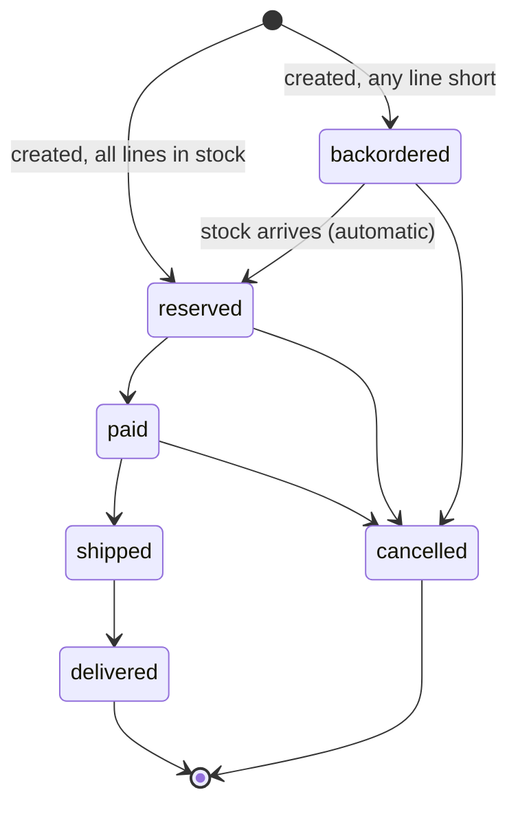

# Architecture

## The one rule

**The API owns state and rules. The automation tools own side effects.**

Stock math, order statuses and purchase-order lifecycles live in `app/src/inventory.js`, in one process, with one source of truth. n8n, Zapier and Make never compute stock. They react to events and call the API back. That keeps the business logic testable and means a misconfigured Zap can't oversell a product.

## Stock math

Every product tracks two numbers:

| Field | Meaning |
|---|---|
| `onHand` | Units physically in the warehouse |
| `reserved` | Units promised to orders that haven't shipped |
| `available` | `onHand - reserved` (computed, never stored) |
| `lowStock` | `available <= reorderPoint` (computed) |

| Action | onHand | reserved |
|---|---|---|
| Order created with enough stock | – | + qty |
| Order shipped | − qty | − qty |
| Order cancelled (reserved or paid) | – | − qty |
| Stock adjusted | ± delta (can't drop below `reserved`) | – |
| Purchase order received | + qty | – |

## Order lifecycle



- An order reserves **all or nothing**. If any line is short, nothing is reserved and `shortages` lists what's missing.
- Whenever stock goes up (adjustment, PO received, or a cancellation freeing stock), backordered orders are checked **oldest first** and reserved automatically.
- Setting the status an order already has is a no-op that returns 200, so retrying automations are safe.
- Invalid moves (shipping an unpaid order) return `409` with the allowed next statuses.

## Purchase orders

`requested → ordered → received`, or `cancelled` from either open state.

- **One open PO per product.** Creating a second returns the existing one with `duplicate: true` and HTTP 200. Low-stock alerts and backorders can both ask for the same restock without doubling it. Send `"dedupe": false` to override.
- **Quantity:** `qty` sets an exact amount. `atLeast` means "this many, or the product's `reorderQty` if that's bigger" (n8n's backorder flow uses this). With neither, the PO uses `reorderQty`.
- **Receiving** adds stock, re-arms the low-stock alert if stock recovered, and fills waiting backorders.

## Low-stock alerts are edge-triggered

`inventory.low_stock` fires **once** when `available` drops to the reorder point, not on every sale while stock stays low. It re-arms when stock climbs back above the reorder point. Without this, every order of a low item would create another reorder attempt.

Seed products that start below their reorder point (TM-12, MUG-ENM) alert on their first stock change, so you can connect your tools before the first alert goes out.

## Events

Every event is stored (last 500, readable at `GET /api/events`) and pushed to matching subscribers.

| Event | When | `data` contains |
|---|---|---|
| `order.created` | New order (reserved or backordered) | The order, including `shortages` |
| `order.status_changed` | Any status change, including automatic allocation | `{ from, to, order }` |
| `inventory.low_stock` | Available stock reaches the reorder point | `{ product, suggestedReorderQty, openPurchaseOrderId }` |
| `inventory.adjusted` | Manual stock adjustment | `{ product, delta, reason }` |
| `purchase_order.created` | New PO (not when deduplicated) | The purchase order |
| `purchase_order.status_changed` | PO ordered, received or cancelled | `{ from, to, purchaseOrder }` |

### Delivery format

```http
POST <subscriber URL>
content-type: application/json
x-inventory-event: order.created
x-inventory-delivery: evt_1003
x-inventory-timestamp: 1792584000
x-inventory-signature: sha256=5d41402abc4b2a76b9719d911017c592...

{ "id": "evt_1003", "type": "order.created", "createdAt": "2026-10-21T12:00:00.000Z", "data": { ... } }
```

- **Retries:** up to 3 retries with exponential backoff (0.5s, 1s, 2s) on network errors, timeouts, 408, 429 and 5xx. Other 4xx responses are not retried.
- **410 Gone** removes the subscription. That's the REST hook convention Zapier uses when a Zap is deleted.
- Delivery is asynchronous: the API responds to the caller first, then delivers.

### Verifying signatures

The signature is an HMAC-SHA256 of `"<timestamp>.<raw body>"`. Static subscriptions use `WEBHOOK_SECRET`. Hooks created through `POST /api/hooks` get their own secret, returned once at creation.

```js
const crypto = require('node:crypto');

function verify(secret, timestamp, rawBody, signature) {
  if (Math.abs(Date.now() / 1000 - Number(timestamp)) > 300) return false; // reject replays
  const expected = 'sha256=' + crypto.createHmac('sha256', secret).update(`${timestamp}.${rawBody}`).digest('hex');
  return expected.length === signature.length && crypto.timingSafeEqual(Buffer.from(expected), Buffer.from(signature));
}
```

`verifySignature` in `app/src/events.js` does this, and so does the n8n **Inventory Trigger** node. Workflow 01 has a disabled Code node with the same check.

## Two ways to subscribe

| | Static routes | REST hooks |
|---|---|---|
| How | `WEBHOOK_SUBSCRIPTIONS` env var | `POST /api/hooks` / `DELETE /api/hooks/:id` |
| Used by | n8n workflows 01–02, Make blueprint 01 | Zapier triggers, the n8n Inventory Trigger, the Make custom app |
| Secret | `WEBHOOK_SECRET` | One per hook |
| Lifecycle | Edit env, restart | The tool subscribes when a Zap or workflow turns on and unsubscribes when it turns off |

Format for static routes: comma-separated `event=url`, `|` between several events, `*` for all:

```
order.created=http://n8n:5678/webhook/inv-order-created,inventory.low_stock|purchase_order.created=https://hook.us1.make.com/abc
```

## Idempotency, because automations retry

| Situation | Protection |
|---|---|
| A Zap or scenario retries "create order" | Send `externalId`; the same value returns the existing order (200, `duplicate: true`) |
| Two flows request the same restock | One open PO per product |
| A status update is retried | Same status is a no-op |
| An event is delivered twice | Each event has a unique `id` (`x-inventory-delivery`) to dedupe on |

## Code map

| File | Responsibility |
|---|---|
| `app/src/inventory.js` | All business rules: products, stock, orders, purchase orders, report |
| `app/src/events.js` | Event log, webhook delivery, retries, signatures |
| `app/src/app.js` | HTTP routes, API-key auth, hook endpoints |
| `app/src/store.js` | JSON file persistence (swap for a database) |
| `app/src/validate.js` | Input checks that accept the string numbers Zapier and Make often send |
| `app/src/config.js` | Environment variables |

### Swapping the store

`InventoryService` touches storage only through `store.data` (arrays of plain objects), `store.nextId(prefix)` and `store.save()`. To move to Postgres, replace the arrays with repository calls inside `inventory.js` and wrap each public method in a transaction. Reservation and shipping must be atomic once more than one process writes.
